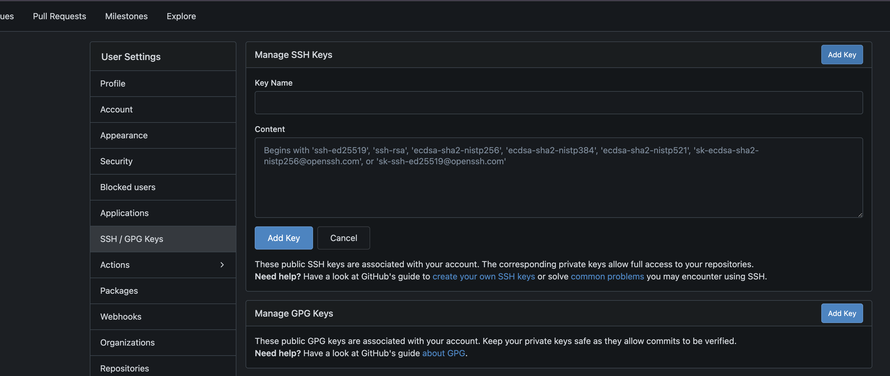

# Guide to Students

You must read this document carefully before starting any of your assignment.

## xv6 Overview

- What is xv6?

  xv6 is a simple Unix-like operating system developed for educational purposes. It is designed to be small and easy to understand, making it an ideal platform for learning about operating systems.

- What is QEMU?

  xv6 runs on QEMU, which is a machine emulator that allows you to run one operating system of a different architecture on another machine. In this case, we run the riscv64 xv6 operating system on your machine (x86_64 or arm64).

## xv6 Directory Structure

The xv6 directory structure is organized as follows:

```plain
xv6-Template/
├── Makefile          # Build instructions for xv6
├── kernel/           # Kernel source code
├── user/             # User programs and libraries
├── mkfs/             # Filesystem creation code
```

- `kernel/`: Contains the source code for the xv6 kernel, including operating system initialization, process management, system calls, memory management, file system, and device drivers.
- `user/`: Contains user-level programs and libraries, including the shell, utilities, applications, and other user-space code.
  - You can also add your own user programs here.

## Git Overview

### What is Git?
  
Git is a version control system that allows you to track changes in your code and collaborate with others.

We will use Git to manage our xv6 guides, spec and template. Any updates to the template will be pushed to the repository, and we will announce if there are any changes.

Learn to cooperate with your team members using Git.

### Basic Git Commands

- `git clone <repository-url>`: Clone a remote repository to your local machine.
- `git pull`: Fetch and merge changes from the remote repository.
- `git pull --rebase`(recommended): Fetch changes from the remote repository and rebase your local changes on top of them.
- `git add <file>`: Stage changes for commit.
  - `git add .`: Stage all changes in the current directory.
- `git status`: Show the status of changes in the repository.
- `git diff`: Show the differences between staged and unstaged changes.
- `git commit`: Commit staged changes to the repository, will open an editor for you to write a commit message.
- `git commit -m "<message>"`: Commit staged changes with a message.
- `git push`: Push committed changes to the remote repository.>
  - `git push <remote> <local-branch>:<remote-branch>`: Push changes from a local branch to a remote branch.
    - If `<local-branch>` is `HEAD`, it means the current branch you are on.
- `git push -d <remote> <remote-branch>`: Delete a remote branch.
- `git branch`: List all local branches in the repository.
  - `git branch -av`: List all local + remote branches with their last commit.
- `git branch <branch>`: Create a new branch above the current branch.
- `git branch -d <branch>`: Delete a local branch.
- `git checkout <branch>`: Switch to a different branch.

## Rule for submission

- Follow the [section](#how-to-submit-your-assignment) to submit your assignment.
- Use the git system at [git.lsalab.cs.nthu.edu.tw](https://git.lsalab.cs.nthu.edu.tw) to submit your assignment.
  - We will email you the repository URL and your team ID.
- You must push to the repository we created for your team.
- You must push to the remote branch `os<year>-mp<1|2|3|4>`, where `<1|2|3|4>` is the assignment number.
  - For example for OS 2026, the branch name for MP1 is `os26-mp1`, for MP2 is `os26-mp2`, and so on.
- You can push multiple commits before the deadline, we will grade the final commit before the deadline.

## Rule for bonus

- The bonus task for MP1 to MP4 is to design your own testcase.
  - Explain your efforts in your report.
  - Not all functions need to be tested, just do your best to cover the important parts of your code.
  - It is good if yours can cover the edge cases that the original test cases do not cover.
  - Your score will be determined by the completeness of the test cases and your explanation.
  - Similar to the original test cases, you can separate your test cases into different functions instead of putting everything in one function.
- Refer to `grade-mp#-public` to see how to write your test cases.
  - The testing script is written in Python, depending on the `gradelib.py` library.
  - Follow the format of the original test cases. You can leverage regex to search for patterns in the output.
- Name your bonus test case script as `grade-mp#-bonus`, where `#` is the assignment number (1 to 4).

## Plagiarism Policy

- Never show your code to others.
- If your code is found to be similar to others, including sources from the internet, and you cannot answer questions properly about your code during the demo, you will be considered as plagiarizing and will receive a score of 0 for the assignment.

## Setting up your environment

Take os26 mp1 as an example, you can follow the steps below to set up your environment:

1. Clone the repository:

    ```bash
    git clone https://git.lsalab.cs.nthu.edu.tw/os26/os26_shared_xv6.git xv6
    ```

2. Navigate to the directory:

    ```bash
    cd xv6
    ```

3. (Important! For Windows users) Configure Git to handle line endings correctly:

    ```bash
    git config core.autocrlf false
    git rm --cached -r .
    git reset --hard
    ```

    If you don't do this, you will probably encounter the error `/usr/bin/env: 'python3\r': No such file or directory` when running a script inside the Docker container.

4. Checkout the specific branch for the lab:

    ```bash
    git checkout os26-mp1
    ```

5. Now you can start working on the assignment. The template will provide you with the necessary files and structure to begin
   - Spec is in file `MP1-spec.md`
   - Grading script is in `grade-mp1-public`

6. Follow the [section](#how-to-submit-your-assignment) to setup the submission remote repository.

## How to run xv6

### Run on your local machine

1. Clone the repository and navigate to the directory:

    ```bash
    cd <your-cloned-repo>
    ```

2. Install the required dependencies
3. Start xv6:

    ```bash
    make qemu
    ```

    This will start the xv6 operating system in a QEMU virtual machine.

4. To quit xv6, press `<Ctrl+a x>`.

### Run with Docker (Recommended)

Running with Docker offers a convenient way to set up your environment without installing dependencies directly on your machine. While its performance (execution time) might not match native execution, it generally won't compromise correctness.

1. Clone the repository and navigate to the directory:

    ```bash
    cd <your-cloned-repo>
    ```

2. Pull the built image:

    ```bash
    # For amd64 architecture (e.g., most Intel/AMD processors):
    docker pull dasbd72/xv6:amd64
    # For arm64v8 architecture (e.g., Apple Silicon):
    docker pull dasbd72/xv6:arm64v8
    ```

3. Run the Docker container with the following command:
    1. For MacOS and Linux:

        ```bash
        # For amd64 architecture (e.g., most Intel/AMD processors):
        docker run -it --rm -v $(pwd):/xv6 -v /xv6/mkfs -v $(pwd)/mkfs/mkfs.c:/xv6/mkfs/mkfs.c -w /xv6 --platform linux/amd64 dasbd72/xv6:amd64
        # For arm64v8 architecture (e.g., Apple Silicon):
        docker run -it --rm -v $(pwd):/xv6 -v /xv6/mkfs -v $(pwd)/mkfs/mkfs.c:/xv6/mkfs/mkfs.c -w /xv6 --platform linux/arm64/v8 dasbd72/xv6:arm64v8
        ```

    2. For Windows PowerShell:

        ```bash
        # For amd64 architecture (e.g., most Intel/AMD processors):
        docker run -it --rm -v ${PWD}:/xv6 -v /xv6/mkfs -v ${PWD}/mkfs/mkfs.c:/xv6/mkfs/mkfs.c -w /xv6 --platform linux/amd64 dasbd72/xv6:amd64
        # For arm64v8 architecture (e.g., Apple Silicon):
        docker run -it --rm -v ${PWD}:/xv6 -v /xv6/mkfs -v ${PWD}/mkfs/mkfs.c:/xv6/mkfs/mkfs.c -w /xv6 --platform linux/arm64/v8 dasbd72/xv6:arm64v8
        ```

    3. For Windows CMD:

        ```bash
        # For amd64 architecture (e.g., most Intel/AMD processors):
        docker run -it --rm -v %cd%:/xv6 -v /xv6/mkfs -v %cd%/mkfs/mkfs.c:/xv6/mkfs/mkfs.c -w /xv6 --platform linux/amd64 dasbd72/xv6:amd64
        # For arm64v8 architecture (e.g., Apple Silicon):
        docker run -it --rm -v %cd%:/xv6 -v /xv6/mkfs -v %cd%/mkfs/mkfs.c:/xv6/mkfs/mkfs.c -w /xv6 --platform linux/arm64/v8 dasbd72/xv6:arm64v8
        ```

4. Start xv6:

    ```bash
    make qemu
    ```

    This will start the xv6 operating system in a QEMU virtual machine.

5. To quit xv6, press `<Ctrl+a x>`.
6. To exit the Docker container, type `exit` in the terminal.

## How to run the grading scripts

1. Make sure you are in the working environment of xv6. For example, in the Docker container terminal or the Linux/Mac environment that can build xv6.

2. Run the grading script to grade the entire assignment:

    ```bash
    ./grade-mp1-public
    # or ./grade-mp2-public
    # or ./grade-mp3-public
    # or ./grade-mp4-public
    ```

    - Append the test case name to the command to grade a specific test case. For example, to grade the `trace 32 grep` test case in MP1, you can run:

      ```bash
      ./grade-mp1-public "trace 32 grep"
      ```

## How to submit your assignment

1. Login to the gitea server [git.lsalab.cs.nthu.edu.tw](https://git.lsalab.cs.nthu.edu.tw) with the account we emailed you.

2. Add your SSH public key to your account settings. If you don't have an SSH key, you can generate one by following:

    ```bash
    # Generate an SSH key if you don't have one
    ssh-keygen -t ed25519

    # Get your public key and copy it to your clipboard
    # Windows (PowerShell)
    cat $env:USERPROFILE\.ssh\id_ed25519.pub
    # Windows (CMD)
    type %USERPROFILE%\.ssh\id_ed25519.pub
    # Linux / MacOS
    cat ~/.ssh/id_ed25519.pub

    # Add the public key to your account settings on the gitea server
    ```

    Add the copied public key to the "SSH Keys" section in your account settings.

    

3. Each team has a repository named `os<year>_team<team-id>_xv6`, for example `os26_team01_xv6`. You can find it after logging in.

4. Add the remote url of your repository to your local git:

    ```bash
    # Replace <year> and <team-id> with your actual year and team id
    git remote add submit git@git.lsalab.cs.nthu.edu.tw:os<year>/os<year>_team<team-id>_xv6.git
    # Verify the remote url is added correctly
    git remote -v
    ```

5. Push your code to the remote repository:

    ```bash
    # Checkout to your assignment branch, for example os26-mp1
    git checkout os26-mp1
    # Add all your changes
    git add .
    # Commit your changes with a message
    git commit -m "Some message describing your changes"
    # Push your changes to the branch of the remote repository
    # Explanation:
    #   - HEAD means the current branch you are on
    #   - os26-mp1 means the name of the branch you are going to push to/update to the remote repository
    git push submit HEAD:<remote-branch-name>
    # git push submit HEAD:os26-mp1
    # git push submit HEAD:os26-mp2  # for mp2
    # git push submit HEAD:os26-mp3  # for mp3
    # git push submit HEAD:os26-mp4  # for mp4
    ```
