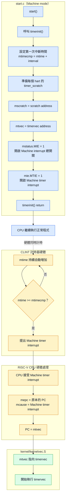
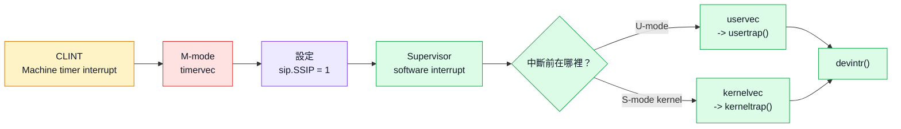

## Timer interrupt
xv6 在開機時會由每個 hart 執行 `timerinit()`，來維護其clock並使其能夠在多個process之間切換
`timerinit()` 的主要工作包含
1. 設定第一次計時器中斷的時間
2. 準備每個 hart (CPU)專屬的暫存空間
3. 將 timervec 的地址寫入 mtvec
4. 開啟 Machine-mode timer interrupt (RISC-V要求timer 中斷在machine mode下處理，而不是supervisor mode下處理)

```
note:
timerinit() 不會直接呼叫 timervec
當 CLINT 偵測到 mtime >= mtimecmp 時，才會提出 Machine timer interrupt
CPU 接受中斷後，會根據 mtvec 自動跳到 timervec
```



### 設定第一次計時器中斷
1. timerinit() 首先讀取目前的 hart ID
```cpp
int id = r_mhartid();
```
每個 hart 都有各自的 mtimecmp，因此必須透過 mhartid 找到目前執行的 hart

2. 接著設定計時器間隔
```cpp
int interval = 10000;
```
3. 並將目前 hart 的 mtimecmp 設為現在時間加上一個 interval
```cpp
*(uint64*)CLINT_MTIMECMP(id) = *(uint64*)CLINT_MTIME + interval;
```
其中
- mtime 是 CLINT 內部持續增加的硬體時間計數器
- mtimecmp[id] 是 hart id 的計時器比較值

可以簡化理解為
```cpp
mtimecmp[id] = mtime + 10000
```
當 CLINT 偵測到 `mtime >= mtimecmp[id]` 就會向該 hart 提出 Machine timer interrupt

### 準備每個 hart 的 scratch area
xv6 宣告了以下二維陣列
```cpp
uint64 timer_scratch[NCPU][5];
```
每個 hart 都有自己的一列暫存空間 `uint64 *scratch = &timer_scratch[id][0];`

| 元素         | Byte offset | 用途                            |
| ------------ | ----------: | ------------------------------- |
| `scratch[0]` |           0 | 保存原本的 `a1`                 |
| `scratch[1]` |           8 | 保存原本的 `a2`                 |
| `scratch[2]` |          16 | 保存原本的 `a3`                 |
| `scratch[3]` |          24 | 保存 `mtimecmp` register 的地址 |
| `scratch[4]` |          32 | 保存 timer interval             |

```
note:
scratch[3] 本身不是 CLINT register
而是普通 RAM 中的一格，裡面保存 CLINT mtimecmp register 的地址
```
最後 `w_mscratch((uint64)scratch);`將 scratch area 的起始地址寫入 mscratch CSR

### 設定 trap handler 並開啟中斷
`w_mtvec((uint64)timervec);`將 `timervec` 的地址寫入 `mtvec` ，它不會立即跳到 `timervec`，只是設定未來發生 
Machine-mode trap 時的入口地址

接著開啟 Machine-mode interrupt:`w_mstatus(r_mstatus() | MSTATUS_MIE);`，此行保留 mstatus 的其他欄位，
並將 MIE 設為 1 `mstatus.MIE = 1`後，再開啟 Machine timer interrupt `w_mie(r_mie() | MIE_MTIE);`，
設定完成後，timerinit() 返回，CPU 繼續執行後續的開機流程

### CPU 如何進入 timervec
當 CLINT 偵測到:`mtime >= mtimecmp`時，Machine timer interrupt 會成為 pending
，CPU 接受中斷時，硬體會保存原本的執行位置，並將 PC 改為 mtvec 所保存的地址
```cpp
mepc = 原本被中斷的 PC
mcause = Machine timer interrupt
PC = mtvec
```
因此 CPU 會開始執行 kernel/kernelvec.S 中的 timervec
```
note:
這裡沒有 timervec();
或是 call timervec
類似的方式呼叫
所以進入 timervec的方式是CPU 硬體在接受中斷時自動完成
```

### 進入`timervec` 保存暫存器
進入 timervec 後，第一條指令為 `csrrw a0, mscratch, a0`，此指令交換 a0 與 mscratch 的值
例如:
```cpp
交換前：
a0       = 被中斷程式原本的 a0
mscratch = scratch area 地址

交換後：
a0       = scratch area 地址
mscratch = 被中斷程式原本的 a0
```
因此，原本的 a0 被暫存在 mscratch，而 a0 則可作為 scratch area 的指標

接著保存 a1、a2 和 a3
```cpp
sd a1, 0(a0)
sd a2, 8(a0)
sd a3, 16(a0)
```

效果等價為
```cpp
scratch[0] = 原本的 a1
scratch[1] = 原本的 a2
scratch[2] = 原本的 a3
```

### 安排下一次計時器中斷
```cpp
ld a1, 24(a0)
ld a2, 32(a0)
```
第一行從 `scratch[3]` 取出 `mtimecmp` 的地址，第二行從 `scratch[4]` 取出 `interval`
```cpp
a1 = mtimecmp 的地址
a2 = interval
```
接著
```cpp
ld a3, 0(a1)
add a3, a3, a2
sd a3, 0(a1)
```
效果相當於
```cpp
mtimecmp = mtimecmp + interval
```

### 將事件轉交給 Supervisor mode
```cpp
li a1, 2
csrw sip, a1
```
數字 2 的二進位為 `2 = 0b10 = 1 << 1`，且sip 的 bit 1 是 SSIP，因此這兩行會設定 `sip.SSIP = 1`，
也就是產生一個 Supervisor software interrupt，通知在 Supervisor mode 執行的 xv6 kernel 處理此次 timer event
因此中斷轉交流程為


### 恢復暫存器並返回
timervec 先恢復 a1 至 a3，接著再次交換 a0 與 mscratch
```cpp
ld a3, 16(a0)
ld a2, 8(a0)
ld a1, 0(a0)
csrrw a0, mscratch, a0
```
如此便恢復被中斷程式原本的 a0 至 a3，同時讓 mscratch 繼續保存 scratch area 地址，供下一次 timer interrupt 使用
最後`mert`根據 mepc 和 mstatus 中保存的狀態，返回中斷前的 privilege mode 與執行位置

## User Space Interrupt Handler
### 整體流程
當 xv6 準備讓 process 返回 user space 時，會執行 `usertrapret()`，`usertrapret()` 將 stvec 設為 uservec，
並準備 trapframe、sstatus、sepc 與 user page table，接著透過 trampoline.S 中的 userret 恢復 user registers，
最後使用 sret 返回 U-mode

當 user program 執行期間發生 timer interrupt 時，前一節的 timervec 會將 sip.SSIP 設為 1，
形成 Supervisor software interrupt，CPU 接受此中斷後根據 stvec 進入 uservec，
uservec 保存 user registers、切換至 kernel page table 與 kernel stack，再跳至 usertrap()

usertrap() 呼叫 devintr() 判斷中斷類型，如果是由 Machine timer interrupt 轉送而來的 Supervisor software interrupt，
devintr() 會呼叫 clockintr() 更新系統時間

```mermaid
flowchart LR
    A["usertrapret()"]
    B["stvec = uservec<br/>準備 trapframe"]
    C["userret + sret"]
    D["U-mode<br/>User process"]
    E["Timer interrupt<br/>sip.SSIP = 1"]
    F["CPU 根據 stvec<br/>進入 uservec"]
    G["保存 user registers<br/>切換 kernel 環境"]
    H["usertrap()"]
    I["devintr()"]
    J["clockintr()<br/>ticks++"]

    A --> B --> C --> D --> E --> F --> G --> H --> I --> J

    classDef kernel fill:#dbeafe,stroke:#2563eb,color:#111827
    classDef user fill:#dcfce7,stroke:#16a34a,color:#111827
    classDef hardware fill:#fef3c7,stroke:#d97706,color:#111827
    classDef handler fill:#ede9fe,stroke:#7c3aed,color:#111827

    class A,B,H,I,J kernel
    class C,D user
    class E,F hardware
    class G handler
```



### `usertrapret()`：準備返回 user space

`usertrapret()` 執行時，CPU 位於 S-mode kernel，它首先關閉 interrupt
```c
intr_off();
```

這是因為 xv6 正在切換 trap handler、page table 與 registers，
如果切換還沒完成就發生 interrupt，CPU 可能使用不完整的 kernel 或 user context

接著，`usertrapret()` 將 trampoline 中 `uservec` 的地址寫入 `stvec`
```c
uint64 trampoline_uservec = TRAMPOLINE + (uservec - trampoline);
w_stvec(trampoline_uservec);
```

其效果為
```text
stvec = uservec 的虛擬地址
```

這表示未來 user process 發生 Supervisor trap 時，CPU 應該從 `uservec` 開始執行

接著，`usertrapret()` 將 `uservec` 需要的 kernel 資訊寫入目前 process 的 trapframe
```c
p->trapframe->kernel_satp = r_satp();
p->trapframe->kernel_sp = p->kstack + PGSIZE;
p->trapframe->kernel_trap = (uint64)usertrap;
p->trapframe->kernel_hartid = r_tp();
```

這些欄位的用途
| Trapframe 欄位  | 用途                    |
| --------------- | ----------------------- |
| `kernel_satp`   | kernel page table       |
| `kernel_sp`     | process 的 kernel stack |
| `kernel_trap`   | `usertrap()` 的地址     |
| `kernel_hartid` | 目前 hart ID            |

接著設定 `sstatus`
```c
unsigned long x = r_sstatus();
x &= ~SSTATUS_SPP;
x |= SSTATUS_SPIE;
w_sstatus(x);
```

把 `SPP` 清為 0，表示下一次執行 `sret` 時返回 U-mode，`SPIE` 則是用來準備返回後的 interrupt-enable 狀態，
`usertrapret()` 也會設定
```c
w_sepc(p->trapframe->epc);
```

因此
```text
sepc = user process 下一個要執行的 PC
```

最後`usertrapret()` 跳到 `trampoline.S` 中的 `userret`，
`userret` 切換到 user page table、恢復 user registers，再執行
```asm
sret
```

CPU 因此從 S-mode 返回 U-mode，並從 `sepc` 保存的 user PC 繼續執行

### CPU 如何進入 `uservec`
當 user process 執行期間發生 timer interrupt 時，前一節介紹的 M-mode `timervec` 會設定
```text
sip.SSIP = 1
```
產生一個 Supervisor software interrupt

CPU 接受這個 interrupt 時，硬體會
```text
sepc = 被中斷的 user PC
scause = Supervisor software interrupt
sstatus.SPP = U-mode
Privilege mode：U-mode -> S-mode
PC = stvec
```

因為 `usertrapret()` 已將 `stvec` 設為 `uservec`，所以 CPU 會自動進入 `kernel/trampoline.S` 中的 `uservec`，
這裡沒有 `call uservec`控制權轉移，是 CPU 接受 trap 後根據 `stvec` 自動完成

### `uservec`：保存 user context
進入 `uservec` 時，CPU 已位於 S-mode，但仍使用 user page table，registers 也仍是 user process 的內容，
`uservec` 先將 user process 原本的 `a0` 保存到 `sscratch`
```asm
csrw sscratch, a0
```

接著讓 `a0` 指向固定的 `TRAPFRAME` 虛擬地址
```asm
li a0, TRAPFRAME
```

然後將 user registers 保存到目前 process 的 trapframe
```asm
sd ra, 40(a0)
sd sp, 48(a0)
...
sd t6, 280(a0)
```

原本的 `a0` 則從 `sscratch` 取回並保存
```asm
csrr t0, sscratch
sd t0, 112(a0)
```

完成 user registers 的保存後，`uservec` 從 trapframe 取得 kernel 執行環境
```asm
ld sp, 8(a0)
ld tp, 32(a0)
ld t0, 16(a0)
ld t1, 0(a0)
```

其效果為
```text
sp = kernel stack
tp = hart ID
t0 = usertrap() 的地址
t1 = kernel page table
```

接著切換至 kernel page table
```asm
sfence.vma zero, zero
csrw satp, t1
sfence.vma zero, zero
```

最後
```asm
jr t0
```
由於 `t0` 保存 `usertrap()` 的地址，因此 CPU 會進入 `usertrap()`

### `usertrap()`：判斷 trap 原因
`usertrap()` 首先確認 trap 來自 user mode
```c
if((r_sstatus() & SSTATUS_SPP) != 0)
    panic("usertrap: not from user mode");
```

接著將 `stvec` 改為 `kernelvec`
```c
w_stvec((uint64)kernelvec);
```

因為現在已經進入 kernel，若 kernel 執行期間再次發生 trap，應該改由 `kernelvec` 處理，
接著保存被中斷的 user PC
```c
p->trapframe->epc = r_sepc();
```

如果這次 trap 不是 system call，`usertrap()` 的話就會呼叫
```c
else if((which_dev = devintr()) != 0){
    // interrupt 已被處理
}
```
timer interrupt 因此會交給 `devintr()` 判斷跟處理

### `devintr()`:辨識 timer interrupt
`devintr()` 讀取 `scause`
```c
uint64 scause = r_scause();
```

因為 `timervec` 把 Machine timer interrupt 轉成 Supervisor software interrupt，因此
```text
scause = 0x8000000000000001
```

其中最高 bit 為 1，代表這是一個 interrupt；
cause code 為 1，代表 Supervisor software interrupt

所以會進入
```c
else if(scause == 0x8000000000000001L){
    if(cpuid() == 0){
        clockintr();
    }

    w_sip(r_sip() & ~2);
    return 2;
}
```

只有 CPU 0 呼叫 `clockintr()`，避免多個 hart 對全域 `ticks` 重複計數，接著
```c
w_sip(r_sip() & ~2);
```

將 `sip.SSIP` 清為 0，表示此次 Supervisor software interrupt 已處理完成，
最後回傳 `2`，表示此次中斷是 timer interrupt

### `clockintr()`:更新系統時間

`clockintr()` 的內容如下
```c
void
clockintr()
{
    acquire(&tickslock);
    ticks++;
    wakeup(&ticks);
    release(&tickslock);
}
```

他的工作有
1. 取得保護 `ticks` 的 spinlock
2. 將全域時間 `ticks` 加一
3. 喚醒正在等待 `ticks` 改變的 process
4. 釋放 spinlock

用 `tickslock` 是為了避免同時存取 `ticks` 而產生 race condition，
`devintr()` 回傳 `2` 後，`usertrap()` 會得知此次為 timer interrupt

```c
if(which_dev == 2)
    implicityield();
```

目前 process 可能會讓出 CPU，讓 scheduler 選擇其他 process 執行，
處理完成後，`usertrap()` 再次呼叫 `usertrapret()`，準備返回 user space

### 小結
`usertrapret()` 的工作是準備返回 user space，以及設定未來來自 user space 的 trap 入口，
真正發生 interrupt 時，CPU 才會根據 `stvec` 進入 `uservec`，
`uservec` 保存 user context 並切換至 kernel 環境，
再由 `usertrap()`、`devintr()` 和 `clockintr()` 完成 timer interrupt 的處理

## Kernel Space Interrupt Handler

```mermaid
flowchart LR
    A["usertrap()"]
    B["stvec = kernelvec"]
    C["S-mode kernel<br/>繼續執行"]
    D["Timer interrupt<br/>sip.SSIP = 1"]
    E["CPU 根據 stvec<br/>進入 kernelvec"]
    F["保存 kernel registers"]
    G["kerneltrap()"]
    H["devintr()"]
    I["clockintr()<br/>ticks++"]
    J["可能執行<br/>implicityield()"]
    K["恢復 sepc、sstatus<br/>與 kernel registers"]
    L["sret"]

    A --> B --> C --> D --> E --> F --> G --> H --> I --> J --> K --> L

    classDef kernel fill:#dbeafe,stroke:#2563eb,color:#111827
    classDef hardware fill:#fef3c7,stroke:#d97706,color:#111827
    classDef handler fill:#ede9fe,stroke:#7c3aed,color:#111827

    class A,B,C,G,H,I,J,K,L kernel
    class D,E hardware
    class F handler
```



### `usertrap()`:設定 kernel trap 入口
CPU 從 user space 進入 `usertrap()` 後，已經位於 S-mode kernel，
此時 `usertrap()` 會將 `stvec` 改為 `kernelvec`：
```c
w_stvec((uint64)kernelvec);
```

其效果等價
```text
stvec = kernelvec 的地址
```
同理，這個也只是設定未來 kernel 執行期間發生 trap 時的入口
此外相同的概念，先前 CPU 從 user space 發生 trap 時，`stvec` 指向 `uservec`；
進入 kernel 後，`stvec` 必須改為 `kernelvec`

如果 kernel 執行期間又發生 timer interrupt，M-mode 的 `timervec` 會把
```text
sip.SSIP = 1
```
設定為 pending，CPU 接受此 Supervisor software interrupt 時，會由硬體保存 trap 資訊
```text
sepc = 被中斷的 kernel PC
scause = Supervisor software interrupt
sstatus.SPP = 1
PC = stvec
```

因為此時
```text
stvec = kernelvec
```
所以 CPU 會自動進入 `kernel/kernelvec.S` 中的 `kernelvec`

### `kernelvec`：保存 kernel registers
進入 `kernelvec` 時，CPU 已位於 S-mode，並且正在使用目前 process 的 kernel stack，
`kernelvec` 首先在 kernel stack 上保留 256 bytes
```asm
addi sp, sp, -256
```
這塊空間用來保存被中斷時的 kernel registers，接著將 registers 保存到 kernel stack
```asm
sd ra, 0(sp)
sd sp, 8(sp)
sd gp, 16(sp)
sd tp, 24(sp)
sd t0, 32(sp)
...
sd t6, 240(sp)
```

```
note:
kernel 執行期間的 trap 和 user trap 有不同的保存方式
`uservec` 將 user registers 保存到 `p->trapframe`
`kernelvec` 將 kernel registers 直接保存到目前的 kernel stack
```

### `kerneltrap()`:保存 trap 狀態
`kerneltrap()` 首先保存三個重要的 Supervisor CSR
```c
uint64 sepc = r_sepc();
uint64 sstatus = r_sstatus();
uint64 scause = r_scause();
```
這三個 CSR 的用途
| CSR       | 用途                           |
| --------- | ------------------------------ |
| `sepc`    | 保存 kernel 被中斷時的 PC      |
| `sstatus` | 保存 trap 前的 Supervisor 狀態 |
| `scause`  | 記錄此次 trap 的原因           |

接著確認此次 trap 確實來自 S-mode
```c
if((sstatus & SSTATUS_SPP) == 0)
    panic("kerneltrap: not from supervisor mode");
```
`SSTATUS_SPP` 不為 0，表示 trap 發生前 CPU 位於 Supervisor mode，
接著確認進入 `kerneltrap()` 時 interrupt 已被關閉
```c
if(intr_get() != 0)
    panic("kerneltrap: interrupts enabled");
```
CPU 接受 trap 時會自動關閉 Supervisor interrupt，避免在尚未保存完整狀態前再次接受其他 interrupt

### 呼叫 `devintr()`
`kerneltrap()` 使用
```c
if((which_dev = devintr()) == 0){
    panic("kerneltrap");
}
```
來呼叫 `devintr()` 判斷這次 trap 是否為已知的 device interrupt
如果 `devintr()` 回傳 0，表示此次 trap 不是 xv6 能辨認的 device interrupt，
所以 `kerneltrap()` 就會輸出 trap 資訊然後 `panic()`

### `devintr()`：辨認 timer interrupt
`devintr()` 先讀取
```c
uint64 scause = r_scause();
```
對於從 `timervec` 轉送的 timer interrupt
```text
scause = 0x8000000000000001
```
其中
```text
最高 bit = 1：表示 interrupt
cause code = 1：Supervisor software interrupt
```
因此會進入
```c
else if(scause == 0x8000000000000001L){
    if(cpuid() == 0){
        clockintr();
    }

    w_sip(r_sip() & ~2);
    return 2;
}
```
只有 CPU 0 呼叫 `clockintr()`，以防止多個 hart 同時增加全域的 `ticks`

接著
```c
w_sip(r_sip() & ~2);
```
會做清除
```text
sip.SSIP = 0
```

最後回傳值 2 表示此次為 timer interrupt
```c
return 2;
```

### `clockintr()`:更新系統時間
CPU 0 會呼叫
```c
void
clockintr()
{
    acquire(&tickslock);
    ticks++;
    wakeup(&ticks);
    release(&tickslock);
}
```
`clockintr()` 的工作有
1. 取得保護 `ticks` 的 spinlock
2. 將全域 `ticks` 加一
3. 叫醒正在等待 `ticks` 改變的 process
4. 釋放 spinlock

### Timer interrupt 與 `implicityield()`
`devintr()` 回傳 2 後，`kerneltrap()` 會判斷目前是否有正在執行的 process
```c
if(which_dev == 2 &&
    myproc() != 0 &&
    myproc()->state == RUNNING)
    implicityield();
```
由於 `implicityield()` 可能執行 context switch，而且切換期間可能發生其他 trap，
因此 `kerneltrap()` 在返回前必須恢復先前保存的
```c
w_sepc(sepc);
w_sstatus(sstatus);
```
### 返回 `kernelvec`
`kerneltrap()` 執行完成後，會返回 `kernelvec`，
`kernelvec` 從 kernel stack 恢復先前保存的 registers
```asm
ld ra, 0(sp)
ld sp, 8(sp)
ld gp, 16(sp)
...
ld t6, 240(sp)
```

```
note:
`tp` 沒有被恢復，因為 `tp` 在 xv6 中保存目前 hart ID，
而 process 在 `implicityield()` 過程中可能經過 CPU scheduling
```