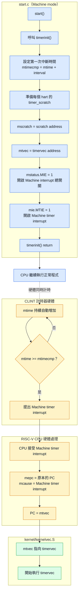
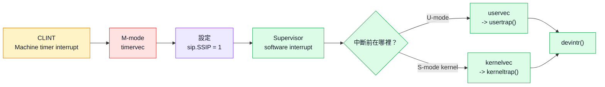

## Timer interrupt
xv6 在開機時會由每個 hart 執行 `timerinit()`，來維護其clock並使其能夠在多個process之間切換
`timerinit()` 的主要工作包含
1. 設定第一次計時器中斷的時間
2. 準備每個 hart (CPU)專屬的暫存空間
3. 將 timervec 的地址寫入 mtvec
4. 開啟 Machine-mode timer interrupt (RISC-V要求timer 中斷在machine mode下處理，而不是supervisor mode下處理)

```
note:
timerinit() 不會直接呼叫 timervec
當 CLINT 偵測到 mtime >= mtimecmp 時，才會提出 Machine timer interrupt
CPU 接受中斷後，會根據 mtvec 自動跳到 timervec
```



### 設定第一次計時器中斷
1. timerinit() 首先讀取目前的 hart ID
```cpp
int id = r_mhartid();
```
每個 hart 都有各自的 mtimecmp，因此必須透過 mhartid 找到目前執行的 hart

2. 接著設定計時器間隔
```cpp
int interval = 10000;
```
3. 並將目前 hart 的 mtimecmp 設為現在時間加上一個 interval
```cpp
*(uint64*)CLINT_MTIMECMP(id) = *(uint64*)CLINT_MTIME + interval;
```
其中
- mtime 是 CLINT 內部持續增加的硬體時間計數器
- mtimecmp[id] 是 hart id 的計時器比較值

可以簡化理解為
```cpp
mtimecmp[id] = mtime + 10000
```
當 CLINT 偵測到 `mtime >= mtimecmp[id]` 就會向該 hart 提出 Machine timer interrupt

### 準備每個 hart 的 scratch area
xv6 宣告了以下二維陣列
```cpp
uint64 timer_scratch[NCPU][5];
```
每個 hart 都有自己的一列暫存空間 `uint64 *scratch = &timer_scratch[id][0];`

| 元素         | Byte offset | 用途                            |
| ------------ | ----------: | ------------------------------- |
| `scratch[0]` |           0 | 保存原本的 `a1`                 |
| `scratch[1]` |           8 | 保存原本的 `a2`                 |
| `scratch[2]` |          16 | 保存原本的 `a3`                 |
| `scratch[3]` |          24 | 保存 `mtimecmp` register 的地址 |
| `scratch[4]` |          32 | 保存 timer interval             |

```
note:
scratch[3] 本身不是 CLINT register
而是普通 RAM 中的一格，裡面保存 CLINT mtimecmp register 的地址
```
最後 `w_mscratch((uint64)scratch);`將 scratch area 的起始地址寫入 mscratch CSR

### 設定 trap handler 並開啟中斷
`w_mtvec((uint64)timervec);`將 `timervec` 的地址寫入 `mtvec` ，它不會立即跳到 `timervec`，只是設定未來發生 
Machine-mode trap 時的入口地址

接著開啟 Machine-mode interrupt:`w_mstatus(r_mstatus() | MSTATUS_MIE);`，此行保留 mstatus 的其他欄位，
並將 MIE 設為 1 `mstatus.MIE = 1`後，再開啟 Machine timer interrupt `w_mie(r_mie() | MIE_MTIE);`，
設定完成後，timerinit() 返回，CPU 繼續執行後續的開機流程

### CPU 如何進入 timervec
當 CLINT 偵測到:`mtime >= mtimecmp`時，Machine timer interrupt 會成為 pending
，CPU 接受中斷時，硬體會保存原本的執行位置，並將 PC 改為 mtvec 所保存的地址
```cpp
mepc = 原本被中斷的 PC
mcause = Machine timer interrupt
PC = mtvec
```
因此 CPU 會開始執行 kernel/kernelvec.S 中的 timervec
```
note:
這裡沒有 timervec();
或是 call timervec
類似的方式呼叫
所以進入 timervec的方式是CPU 硬體在接受中斷時自動完成
```

### 進入`timervec` 保存暫存器
進入 timervec 後，第一條指令為 `csrrw a0, mscratch, a0`，此指令交換 a0 與 mscratch 的值
例如:
```cpp
交換前：
a0       = 被中斷程式原本的 a0
mscratch = scratch area 地址

交換後：
a0       = scratch area 地址
mscratch = 被中斷程式原本的 a0
```
因此，原本的 a0 被暫存在 mscratch，而 a0 則可作為 scratch area 的指標

接著保存 a1、a2 和 a3
```cpp
sd a1, 0(a0)
sd a2, 8(a0)
sd a3, 16(a0)
```

效果等價為
```cpp
scratch[0] = 原本的 a1
scratch[1] = 原本的 a2
scratch[2] = 原本的 a3
```

### 安排下一次計時器中斷
```cpp
ld a1, 24(a0)
ld a2, 32(a0)
```
第一行從 `scratch[3]` 取出 `mtimecmp` 的地址，第二行從 `scratch[4]` 取出 `interval`
```cpp
a1 = mtimecmp 的地址
a2 = interval
```
接著
```cpp
ld a3, 0(a1)
add a3, a3, a2
sd a3, 0(a1)
```
效果相當於
```cpp
mtimecmp = mtimecmp + interval
```

### 將事件轉交給 Supervisor mode
```cpp
li a1, 2
csrw sip, a1
```
數字 2 的二進位為 `2 = 0b10 = 1 << 1`，且sip 的 bit 1 是 SSIP，因此這兩行會設定 `sip.SSIP = 1`，
也就是產生一個 Supervisor software interrupt，通知在 Supervisor mode 執行的 xv6 kernel 處理此次 timer event
因此中斷轉交流程為


### 恢復暫存器並返回
timervec 先恢復 a1 至 a3，接著再次交換 a0 與 mscratch
```cpp
ld a3, 16(a0)
ld a2, 8(a0)
ld a1, 0(a0)
csrrw a0, mscratch, a0
```
如此便恢復被中斷程式原本的 a0 至 a3，同時讓 mscratch 繼續保存 scratch area 地址，供下一次 timer interrupt 使用
最後`mert`根據 mepc 和 mstatus 中保存的狀態，返回中斷前的 privilege mode 與執行位置